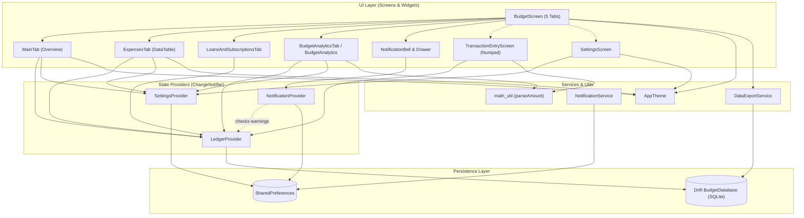

# BudgetKo / Tasker - Codebase Function Map & Symbol Directory

> **For AI Agents & Developers**: Consult this reference first before spending tokens grepping, searching, or reading multiple files across the repository.

---

## Table of Contents

1. [Quick "Where Do I Look?" Lookup Table](#1-quick-where-do-i-look-lookup-table)
2. [Architectural Overview & Data Flow](#2-architectural-overview--data-flow)
3. [Core Layer Breakdown](#3-core-layer-breakdown)
   - [3.1 Entry Point (`lib/main.dart`)](#31-entry-point-libmaindart)
   - [3.2 Database Layer (`lib/database/`)](#32-database-layer-libdatabase)
   - [3.3 State Providers (`lib/providers/`)](#33-state-providers-libproviders)
   - [3.4 Services Layer (`lib/services/`)](#34-services-layer-libservices)
   - [3.5 Utilities (`lib/utils/`)](#35-utilities-libutils)
   - [3.6 Design System & Theming (`lib/theme/`)](#36-design-system--theming-libtheme)
   - [3.7 Screens (`lib/screens/`)](#37-screens-libscreens)
   - [3.8 Reusable Widgets (`lib/widgets/`)](#38-reusable-widgets-libwidgets)
4. [Legacy / Pivot Archive (`tasko_pivot/`)](#4-legacy--pivot-archive-tasko_pivot)
5. [Verification & Linter Rules](#5-verification--linter-rules)

---

## 1. Quick "Where Do I Look?" Lookup Table

| Task / Feature | File Path | Key Symbol(s) |
| :--- | :--- | :--- |
| **App Initialization & DI** | `lib/main.dart` | `main()`, `BudgetKoApp`, `MultiProvider` |
| **Database Schema & Migrations** | `lib/database/budget_database.dart` | `BudgetDatabase`, `Accounts`, `Categories`, `Transactions`, `Loans`, `Subscriptions` |
| **Generated DB Code** | `lib/database/budget_database.g.dart` | Drift tables, companion classes, DAOs |
| **Account Balance & CRUD** | `lib/providers/ledger_provider.dart` | `addAccount()`, `updateAccount()`, `deleteAccount()`, `accounts` |
| **Budget Limit & Category CRUD** | `lib/providers/ledger_provider.dart` | `addCategory()`, `updateCategory()`, `deleteCategory()`, `categories` |
| **Transaction Processing** | `lib/providers/ledger_provider.dart` | `addTransaction()`, `updateTransaction()`, `deleteTransaction()`, `_updateAccountBalance()` |
| **Loans & Debts State** | `lib/providers/ledger_provider.dart` | `addLoan()`, `updateLoan()`, `deleteLoan()`, `loans` |
| **Subscriptions State** | `lib/providers/ledger_provider.dart` | `addSubscription()`, `updateSubscription()`, `deleteSubscription()`, `subscriptions` |
| **Mock Analytics Data** | `lib/providers/ledger_provider.dart` | `insertMockAnalytics()`, `removeMockAnalytics()` |
| **Theme, Currency & Font Size** | `lib/providers/settings_provider.dart` | `toggleDarkMode()`, `setThemeColor()`, `setFontSize()`, `setCurrency()`, `toggleHideTotalAmount()` |
| **In-App Notification Center** | `lib/providers/notification_provider.dart` | `NotificationProvider`, `AppNotification`, `checkLedgerWarnings()`, `markAsRead()` |
| **OS Notifications & Alarms** | `lib/services/notification_service.dart` | `NotificationService`, `showImmediateNotification()`, `scheduleTestNotification()` |
| **CSV Export & Share** | `lib/services/export_service.dart` | `DataExportService.exportLedgerToCsv()` |
| **Math Expression Calculator** | `lib/utils/math_util.dart` | `parseAmount(String input)` |
| **Theme Tokens & Category Colors** | `lib/theme/app_theme.dart` | `AppTheme.light()`, `AppTheme.dark()`, `AppTheme.categoryColor()` |
| **Main 5-Tab Shell & Top Bar** | `lib/screens/budget_screen.dart` | `BudgetScreen`, `_BudgetScreenState`, `_showAccountDialog()`, `_showCategoryDialog()` |
| **Dashboard / Overview Tab** | `lib/screens/main_tab.dart` | `MainTab` (Total Balance card, Net Positive/Negative, Cashflow, Accounts overview, Recent Activity) |
| **All Expenses DataTable & Zoom** | `lib/screens/expenses_tab.dart` | `ExpensesTab`, `_zoomIn()`, `_zoomOut()`, `DataTable` |
| **Loans & Subscriptions Screen** | `lib/screens/loans_and_subscriptions_tab.dart`| `LoansAndSubscriptionsTab`, `_showLoanDialog()`, `_showSubscriptionDialog()` |
| **Analytics Dashboard Tab** | `lib/screens/budget_analytics_screen.dart`| `BudgetAnalyticsTab` (Debt progress, Subscriptions cost, section toggles) |
| **Analytics Charts & Trends** | `lib/widgets/budget_analytics.dart` | `BudgetAnalytics`, `_getCategoryTrend()`, `_getSpots()`, `FullScreenDonutChart` |
| **Numpad Transaction Creator** | `lib/screens/transaction_entry_screen.dart` | `TransactionEntryScreen`, `_onNumpadTap()`, `_calculateHypotheticalBalance()`, `_saveTransaction()` |
| **Settings Screen** | `lib/screens/settings_screen.dart` | `SettingsScreen` |
| **Notification Bell Widget** | `lib/widgets/notification_bell.dart` | `NotificationBell` (badge counter, drawer opener) |
| **Notification Drawer Widget** | `lib/widgets/notification_drawer.dart` | `NotificationDrawer` |
| **Group Wallet Models** | `lib/models/group_wallet_models.dart` | `GroupProfile`, `GroupWallet`, `GroupMember`, `GroupTransaction` |
| **Group Wallet Provider** | `lib/providers/group_wallet_provider.dart` | `GroupWalletProvider` (local profile, Supabase sync, collective pool math, transactions CRUD) |
| **Group Wallet UI & Window** | `lib/screens/group_wallet_screen.dart` | `GroupWalletScreen`, `GroupWalletTab` (profile card, Supabase config, pool card, member breakdown, transactions) |
| **Supabase SQL Schema** | `lib/database/supabase_schema.sql`, `supabase_schema.sql` | `group_wallets`, `group_members`, `group_transactions`, RLS policies |

---

## 2. Architectural Overview & Data Flow



---

## 3. Core Layer Breakdown

### 3.1 Entry Point (`lib/main.dart`)
- **`void main() async`**:
  - Initializes `WidgetsFlutterBinding`.
  - Instantiates `BudgetDatabase`, `SettingsProvider`, `LedgerProvider`, and `NotificationProvider`.
  - Concurrently preloads dependencies via `Future.wait`:
    1. `NotificationService().initialize()`
    2. `settingsProvider.preload()`
    3. `ledgerProvider.preload()`
    4. `notificationProvider.preload()`
  - Calls `notificationProvider.checkLedgerWarnings(ledgerProvider)` to check low balances, overdue loans, and upcoming subscriptions at startup.
  - Mounts `BudgetKoApp` wrapped in `MultiProvider`.
- **`class NoScrollbarBehavior extends MaterialScrollBehavior`**: Suppresses scrollbars globally for cleaner UI.
- **`class BudgetKoApp extends StatelessWidget`**: Root widget applying theme mode (`light`/`dark`), dynamic theme color, and text scale factor from `SettingsProvider`. Initial route is `BudgetScreen`.

---

### 3.2 Database Layer (`lib/database/`)

#### `lib/database/budget_database.dart`
Drift SQLite database implementation using native background sqlite (`NativeDatabase.createInBackground`).
- **Enums**:
  - `enum TransactionType { income, expense, transfer }`
- **Tables**:
  - **`Accounts extends Table`** (DataClass: `Account`):
    - `id` (int, autoIncrement)
    - `name` (text, min: 1, max: 50)
    - `iconCodePoint` (int)
    - `colorHex` (int)
    - `initialBalance` (real, default 0.0)
    - `currentBalance` (real, default 0.0)
    - `minBalance` (real, default 0.0, warning trigger threshold)
    - `backgroundImagePath` (text, nullable)
  - **`Categories extends Table`** (DataClass: `BudgetCategory`):
    - `id` (int, autoIncrement)
    - `name` (text, min: 1, max: 50)
    - `iconCodePoint` (int)
    - `colorHex` (int)
    - `isExpense` (bool)
    - `monthlyBudgetLimit` (real, nullable)
    - `dailyBudgetLimit` (real, nullable)
    - `weeklyBudgetLimit` (real, nullable)
  - **`Transactions extends Table`** (DataClass: `LedgerTransaction`):
    - `id` (int, autoIncrement)
    - `amount` (real)
    - `date` (dateTime)
    - `notes` (text, nullable)
    - `transactionType` (int: 0=income, 1=expense, 2=transfer)
    - `fromAccountId` (int)
    - `toAccountId` (int, nullable)
    - `categoryId` (int, nullable)
  - **`Loans extends Table`** (DataClass: `Loan`):
    - `id` (int, autoIncrement)
    - `creditorName` (text, min: 1, max: 50)
    - `amount` (real)
    - `remainingAmount` (real)
    - `dueDate` (dateTime)
    - `isPaid` (bool, default false)
    - `isOutgoing` (bool, default false; true = someone owes user, false = user owes creditor)
    - `accountId` (int)
    - `notes` (text, nullable)
  - **`Subscriptions extends Table`** (DataClass: `Subscription`):
    - `id` (int, autoIncrement)
    - `name` (text, min: 1, max: 50)
    - `cost` (real)
    - `billingCycle` (text, min: 1, max: 20: 'Daily', 'Weekly', 'Monthly', 'Yearly')
    - `nextBillingDate` (dateTime)
    - `isActive` (bool, default true)
    - `accountId` (int)
    - `notes` (text, nullable)
- **Class `BudgetDatabase extends _$BudgetDatabase`**:
  - `schemaVersion`: `6`
  - `MigrationStrategy`: handles upgrades `from < 2` through `from < 6` (adding tables `loans`, `subscriptions`, and columns `minBalance`, `isOutgoing`, `backgroundImagePath`, `dailyBudgetLimit`, `weeklyBudgetLimit`).

---

### 3.3 State Providers (`lib/providers/`)

#### `lib/providers/ledger_provider.dart` (`LedgerProvider`)
Central ledger state machine handling all balance adjustments and database synchronization.
- **State Properties**:
  - `List<Account> accounts`: Cached accounts.
  - `List<BudgetCategory> categories`: Cached categories.
  - `List<LedgerTransaction> allTransactions`: All transactions ordered desc by date.
  - `List<LedgerTransaction> recentTransactions`: Top 50 most recent transactions.
  - `List<Loan> loans`: Cached active/inactive loans.
  - `List<Subscription> subscriptions`: Cached subscriptions.
  - `int? lastUsedAccountId`: Sticky default account ID.
  - `int? lastUsedCategoryId`: Sticky default category ID.
- **Methods**:
  - `Future<void> preload()`: Initiates data loading once.
  - `Future<void> refreshData()`: Queries all tables, sorts transactions, calls `notifyListeners()`.
  - **Accounts**:
    - `addAccount(String name, double initialBalance, {int? colorHex, double minBalance, String? backgroundImagePath})`
    - `updateAccount(int accountId, String name, double balance, {int? colorHex, double? minBalance, String? backgroundImagePath, bool clearBackgroundImage})`
    - `deleteAccount(int accountId)`: Deletes account and associated transactions in a DB transaction.
  - **Categories**:
    - `addCategory(String name, bool isExpense, double? monthlyLimit, {double? dailyLimit, double? weeklyLimit, int? colorHex})`
    - `updateCategory(int categoryId, String name, bool isExpense, double? monthlyLimit, {double? dailyLimit, double? weeklyLimit, int? colorHex})`
    - `deleteCategory(int categoryId)`: Unlinks transactions (`categoryId = null`) and deletes category.
  - **Transactions**:
    - `addTransaction({required double amount, required DateTime date, required TransactionType type, required int fromAccountId, int? toAccountId, int? categoryId, String? notes})`: Inserts transaction and adjusts account balances (decrements expense, increments income, transfers between accounts).
    - `updateTransaction({required int transactionId, required double amount, required DateTime date, required TransactionType type, required int fromAccountId, int? toAccountId, int? categoryId, String? notes})`: Reverses old balances and applies new balances atomically.
    - `deleteTransaction(int transactionId)`: Reverses transaction effect on balances and deletes record.
    - `_updateAccountBalance(int accountId, double newBalance)`: Helper for updating account balance.
  - **Loans**:
    - `addLoan({required String creditorName, required double amount, required double remainingAmount, required DateTime dueDate, required int accountId, required bool isOutgoing, String? notes})`
    - `updateLoan({required int loanId, required String creditorName, required double amount, required double remainingAmount, required DateTime dueDate, required bool isPaid, required int accountId, required bool isOutgoing, String? notes})`: Handles balance updates when toggling `isPaid`.
    - `deleteLoan(int loanId)`
  - **Subscriptions**:
    - `addSubscription({required String name, required double cost, required String billingCycle, required DateTime nextBillingDate, required int accountId, String? notes})`
    - `updateSubscription({required int subscriptionId, required String name, required double cost, required String billingCycle, required DateTime nextBillingDate, required bool isActive, required int accountId, String? notes})`
    - `deleteSubscription(int subscriptionId)`
  - **Mock Data**:
    - `insertMockAnalytics()`: Inserts 30 days of randomized expense transactions.
    - `removeMockAnalytics()`: Cleans up mock transactions and restores account balances.

#### `lib/providers/settings_provider.dart` (`SettingsProvider`)
User preference persistence backed by `SharedPreferences`.
- **Properties & Getters**:
  - `bool isDarkMode`: App brightness (default `false`).
  - `String currency`: Currency symbol (default `'₱'`).
  - `int? themeColor`: Custom accent color ARGB integer (default `null`).
  - `String fontSize`: `'Small'`, `'Medium'`, or `'Large'` (default `'Small'`).
  - `bool hideTotalAmount`: Masks balance amounts on Main tab (default `true`).
  - `double textScaleFactor`: `1.0` (Small), `1.15` (Medium), `1.30` (Large).
- **Methods**:
  - `preload()`: Loads from `SharedPreferences`.
  - `toggleDarkMode(bool value)`
  - `toggleHideTotalAmount()`
  - `setHideTotalAmount(bool value)`
  - `setCurrency(String value)`
  - `setThemeColor(int? colorVal)`
  - `setFontSize(String value)`
  - `resetAllSettings()`

#### `lib/providers/notification_provider.dart` (`NotificationProvider`)
In-app notification badge, alerts, and warning evaluator.
- **Classes**:
  - `AppNotification`: Model (`id`, `title`, `message`, `timestamp`, `isRead`, `dueDate`, `entityKey`). Includes `toJson()` and `fromJson()`.
- **Properties**:
  - `List<AppNotification> notifications`
  - `List<AppNotification> unreadNotifications`
  - `Map<String, String> closedDueDates`: Map of entity keys to ISO due dates of closed notifications.
- **Methods**:
  - `preload()`: Loads stored notifications and closed due dates from `SharedPreferences`.
  - `addNotification(AppNotification notification)`: Deduplicates alerts.
  - `closeNotification(String id)`: Dismisses notification and records due date in `closedDueDates`.
  - `markAsRead(String id)`: Marks as read and records due date in `closedDueDates`.
  - `markAllAsRead()`: Marks all as read and records due dates.
  - `clearAll()`: Clears all notifications and records due dates.
  - `checkLedgerWarnings(LedgerProvider ledger)`:
    - Scans for accounts where `currentBalance < minBalance` (Low Balance Warning).
    - Scans for loans where `!isPaid && dueDate.isBefore(now)` (Overdue Loan Warning, suppressed if closed until next due date).
    - Scans for subscriptions due within 3 days (Upcoming Subscription Alert, suppressed if closed until next due date).

#### `lib/providers/group_wallet_provider.dart` (`GroupWalletProvider`)
State provider for managing the collective budget, local member profiles, and Supabase cloud sync.
- **Models Used**:
  - `GroupProfile`: `id`, `name`, `colorHex`, `generateId()`.
  - `GroupWallet`: `id`, `name`, `description`, `currency`, `createdByName`, `createdById`, `createdAt`.
  - `GroupMember`: `id`, `walletId`, `userId`, `name`, `colorHex`, `joinedAt`.
  - `GroupTransaction`: `id`, `walletId`, `amount`, `transactionType` ('expense', 'contribution'), `category`, `notes`, `paidByName`, `paidById`, `paidByColorHex`, `date`, `createdAt`.
- **Properties**:
  - `profile`: Local user profile (`GroupProfile?`).
  - `isConnected`, `isTablesReady`, `isLoading`, `connectionError`.
  - `wallets`: Available group wallets (`List<GroupWallet>`).
  - `currentWallet`: Currently selected group wallet (`GroupWallet?`).
  - `members`: Current wallet members (`List<GroupMember>`).
  - `transactions`: Current wallet transactions (`List<GroupTransaction>`).
- **Methods**:
  - `saveProfile(String name, int colorHex)`: Saves profile locally in `SharedPreferences` and syncs member record to active group wallet.
  - `connectSupabase(String url, String key)`: Connects client, checks tables, attempts auto-init if needed.
  - `disconnectSupabase()`: Clears credentials and resets state.
  - `checkDatabaseTables()`: Verifies `group_wallets` and `group_transactions` tables on remote Postgres.
  - `attemptAutoInitTables()`: Attempts table creation via RPC `exec_sql`.
  - `createWallet(String name, {String? description, String? currency})`: Inserts new group wallet and registers creator as member.
  - `joinWalletById(String walletId)`: Joins an existing group wallet using shared UUID.
  - `deleteWallet(String walletId)`: Deletes group wallet and its associated data, then re-fetches available wallets.
  - `addTransaction(...)`: Records shared expense or contribution into `group_transactions`.
  - `deleteTransaction(String id)`: Removes group transaction.
  - **Collective Math**:
    - `collectivePoolBalance`: Contributions + Income - Expenses.
    - `collectiveTotalIncome`: Total contributed.
    - `collectiveTotalExpenses`: Total spent.
    - `memberExpenseMap`: Map of Member Name $\rightarrow$ Total Spent.
    - `memberContributionMap`: Map of Member Name $\rightarrow$ Total Contributed.
    - `categoryExpensesMap`: Map of Category $\rightarrow$ Total Spent.

---

### 3.4 Services Layer (`lib/services/`)

#### `lib/services/export_service.dart` (`DataExportService`)
- **Constructor**: `DataExportService(this._db)`
- **Method**:
  - `Future<void> exportLedgerToCsv()`:
    - Exports all transactions to CSV format with headers `[ID, Amount, Date, Type, Notes, From Account, To Account, Category]`.
    - Writes file to app documents directory and triggers `Share.shareXFiles()`.

#### `lib/services/notification_service.dart` (`NotificationService`)
Singleton wrapper around `flutter_local_notifications` for Android, iOS, and Linux.
- **Channels**:
  - `budgetko_reminders` (General reminders, high importance).
  - `budgetko_alarms` (Custom / loud audio alarms).
- **Methods**:
  - `initialize()`: Sets up timezone data and platform initialization settings (`LinuxInitializationSettings`, `DarwinInitializationSettings`, `AndroidInitializationSettings`).
  - `requestPermissions()`: Requests notification and exact alarm permissions on Android.
  - `showImmediateNotification(String title, String body, {bool isAlarm = false})`
  - `scheduleTestNotification(int seconds, {bool isAlarm = false})`

---

### 3.5 Utilities (`lib/utils/`)

#### `lib/utils/math_util.dart`
- **`double parseAmount(String input)`**:
  - Uses `math_expressions` (`GrammarParser` + `RealEvaluator`) to evaluate mathematical strings (e.g., `"120 + 45 * 2"`).
  - Falls back to `double.tryParse(input) ?? 0.0` on parser error or empty input.

---

### 3.6 Design System & Theming (`lib/theme/`)

#### `lib/theme/app_theme.dart` (`AppTheme`)
Central source of truth for design tokens, typography, and component styling.
- **Color Constants**:
  - Light tokens: `lightBg` (`#F9F8F6`), `lightCard` (`#F2F2F0`), `lightBorder` (`#E8E7E4`), `lightText` (`#3A3A38`), `lightSubtext` (`#6B6B68`), `lightAccent` (`#A3A6A8`).
  - Dark tokens: `darkBg` (`#1E1E1C`), `darkCard` (`#262624`), `darkBorder` (`#383835`), `darkText` (`#F0EFEB`), `darkSubtext` (`#A1A09C`), `darkAccent` (`#B5B8B9`).
- **Radii**: `radius = 6.0`, `buttonRadius = 5.0`.
- **Font**: `'Inter'` with fallbacks `['Helvetica Neue', 'Helvetica', 'Arial', 'sans-serif']`.
- **Builders**:
  - `static ThemeData light([Color? accentColor])`
  - `static ThemeData dark([Color? accentColor])`
- **Category Colors**:
  - `static Color categoryColor(String category)`: Hash-stable muted palette mapper across 8 tones (Sage, Slate Blue, Terracotta, Ochre, Dusty Rose, Charcoal, Teal, Taupe).

---

### 3.7 Screens (`lib/screens/`)

#### `lib/screens/budget_screen.dart` (`BudgetScreen`)
Main top-level application shell hosting the 5-tab interface.
- **Tabs**:
  1. `Main`: Delegated to `MainTab`.
  2. `Wallet`: Accounts list, Categories with limit summaries, and Recent Transactions preview.
  3. `Expenses`: Delegated to `ExpensesTab`.
  4. `Loans & Subs`: Delegated to `LoansAndSubscriptionsTab`.
  5. `Analytics`: Delegated to `BudgetAnalyticsTab`.
- **Dialogs & Methods**:
  - `_showAccountDialog(BuildContext context, [Account? accountToEdit])`: Create/edit account with ColorPicker and minBalance threshold.
  - `_showCategoryDialog(BuildContext context, [BudgetCategory? categoryToEdit])`: Create/edit category with Daily/Weekly/Monthly limit settings and ColorPicker.
- **Top Bar**: CSV export icon, Currency dropdown selector, `NotificationBell`, and `SettingsScreen` navigation button.
- **FAB**: "Add Transaction" leading to `TransactionEntryScreen`.

#### `lib/screens/main_tab.dart` (`MainTab`)
Hero overview tab summarizing personal finance status.
- **Components**:
  - **Total Balance Card**: Aggregated balance, hide/reveal toggle (`hideTotalAmount`), Net Positive / Net Negative badge.
  - **Cash Flow Summary**: Two side-by-side cards for Total Income (`+currency`) and Total Expenses (`-currency`).
  - **Accounts Overview**: List of accounts with color indicators and minBalance alert tags.
  - **Recent Activity**: 5 latest transactions with category badges and time stamps, plus "View All" link to Wallet tab.

#### `lib/screens/expenses_tab.dart` (`ExpensesTab`)
All expenses tabular ledger.
- **State & Controls**:
  - `_dateFilter`: `'All Time'`, `'This Week'`, `'This Month'`, `'This Year'`.
  - `_scale`: Zoom multiplier for horizontal data table (`0.3` to `4.0`).
  - `_zoomIn()`, `_zoomOut()`: Handled by floating small FABs.
  - `DataTable`: Columns for Account, Category, Expense amount, and Date. Tapping date opens date picker to reassign transaction timestamp.

#### `lib/screens/loans_and_subscriptions_tab.dart` (`LoansAndSubscriptionsTab`)
Debt and recurring subscription tracking.
- **Sections**:
  - **Active Loans / Debts**: List of loans, due dates, remaining balances, mark-paid quick action button. Supports incoming loans (owed to user) and outgoing loans (user owes creditor).
  - **Subscriptions & Bills**: List of recurring expenses, billing cycles ('Weekly', 'Monthly', 'Yearly'), next renewal dates, active status switches.
- **Dialogs**:
  - `_showLoanDialog(...)`
  - `_showSubscriptionDialog(...)`

#### `lib/screens/budget_analytics_screen.dart` (`BudgetAnalyticsTab`)
Analytics aggregation view.
- **Controls**:
  - Date filter selector (`'Today'`, `'This Week'`, `'This Month'`, `'This Year'`).
  - Section visibility popup menu (toggle Charts & Budgets, Loans Summary, Subscriptions).
- **Content**:
  - Embeds `BudgetAnalytics` widget.
  - **Loans Summary Card**: Active debts count, total borrowed, total remaining, payoff progress bar.
  - **Subscriptions Card**: Active count, estimated monthly cost, next upcoming bill badge.

#### `lib/screens/transaction_entry_screen.dart` (`TransactionEntryScreen`)
Interactive numpad transaction creator & editor.
- **Features**:
  - Segmented type selector: `Expense`, `Income`, `Transfer`.
  - On-screen numpad with arithmetic support (`+`, `-`, `=`, `⌫`).
  - Account selectors (from account, to account for transfers).
  - Category selector (for expense/income).
  - Notes field.
  - **Negative Balance Guard**: `_calculateHypotheticalBalance()` warns user and blocks saving if expense/transfer would make account balance negative.

#### `lib/screens/settings_screen.dart` (`SettingsScreen`)
User preferences interface.
- **Controls**:
  - Dark Mode switch.
  - Button Color Scheme picker (`ColorPicker`).
  - Font Size selector (`Small`, `Medium`, `Large`).
  - Hide Total Amount toggle switch.
  - Currency Symbol selector (`₱`, `$`, `€`, `£`, `¥`, `₹`, `₩`).

---

### 3.8 Reusable Widgets (`lib/widgets/`)

#### `lib/widgets/budget_analytics.dart`
- **`class BudgetAnalytics extends StatefulWidget`**:
  - **Budget Limit Progress Bars**: Calculates pro-rated daily/weekly/monthly spending against configured limits.
  - **Category Trend Calculator (`_getCategoryTrend(BudgetCategory c)`)**: Calculates percentage increase/decrease compared to prior period (yesterday, last week, last month, last year).
  - **Line & Bar Charts**: `PageView` with interactive `fl_chart` charts (LineChart & BarChart). Supports tap-to-switch.
  - **Account & Category Horizontal Bars**: `PageView` switching between account balances and expense breakdown.
- **`class FullScreenDonutChart extends StatefulWidget`**:
  - Fullscreen landscape pie chart using `fl_chart.PieChart`.

#### `lib/widgets/notification_bell.dart` (`NotificationBell`)
- Top app bar icon button with unread notification badge counter.
- Evaluates `ledgerProvider` warnings before opening the scaffold's end drawer.

#### `lib/widgets/notification_drawer.dart` (`NotificationDrawer`)
- End drawer listing in-app alerts with read/unread highlighting, "Mark all read", "Clear All", and alert detail popup dialog.

---

## 4. Legacy / Pivot Archive (`tasko_pivot/`)

The following files exist in `tasko_pivot/` from the original task-management codebase before the app pivoted to the BudgetKo ledger:
- `tasko_pivot/task.dart`: Legacy `Task` model (start/end dates, routine intervals, alarm configs, locked status, pdfPath).
- `tasko_pivot/task_provider.dart`: Legacy `TaskProvider` CRUD and filter logic.
- `tasko_pivot/dashboard_screen.dart`, `task_edit_screen.dart`, `task_tile.dart`, `task_list_view.dart`: Legacy task UI.
- `tasko_pivot/heatmap_screen.dart`: GitHub-style productivity heatmap.
- `tasko_pivot/dtr_screen.dart`: Daily time record view.
- `tasko_pivot/platform_pdf_viewer*.dart`: PDF viewer implementations.
- `tasko_pivot/import_export_service.dart`: Zip/markdown task import and export.

> *Note*: Active application code is strictly in `lib/`. Do not edit `tasko_pivot/` unless specifically directed to restore task features.

---

## 5. Verification & Linter Rules

AI agents modifying this codebase must adhere to the following rules:

1. **Format Code**:
   ```bash
   dart format .
   ```
2. **Static Analysis**:
   ```bash
   flutter analyze
   ```
   Must pass with **zero warnings/errors** before completing tasks.
3. **Run Tests**:
   ```bash
   flutter test
   ```
